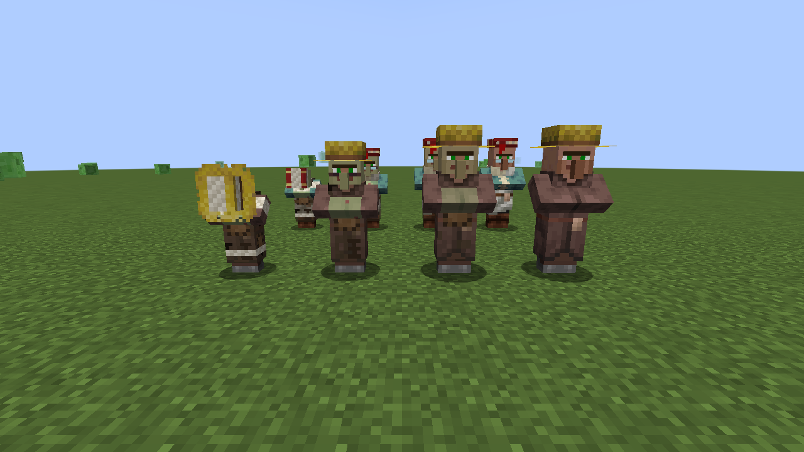
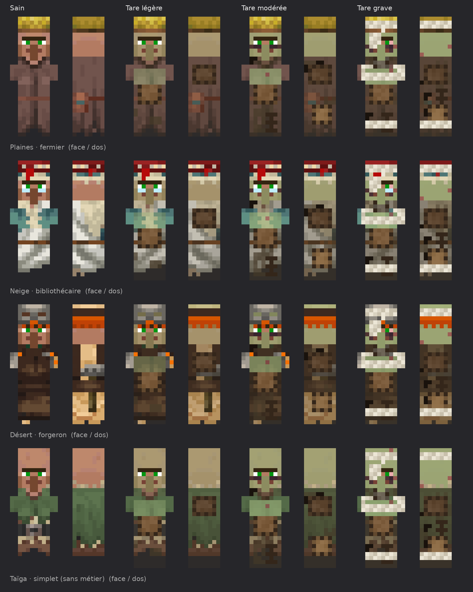
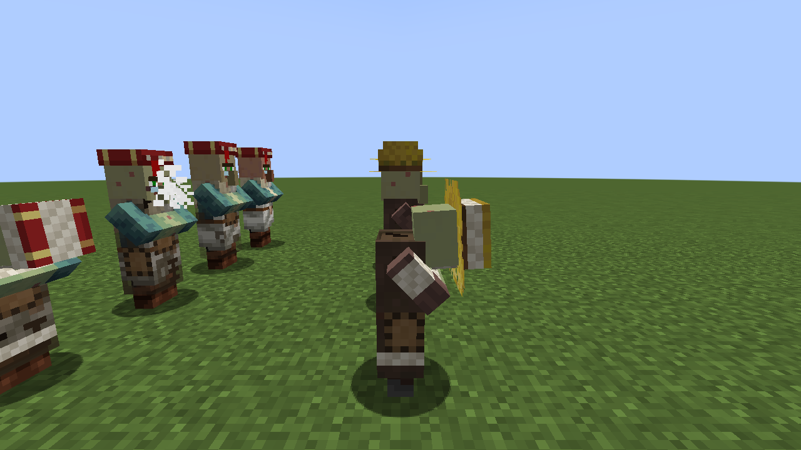

# Consanguinité

Mod Fabric pour Minecraft 1.21.1. Chaque villageois a un arbre généalogique. Quand des villageois trop proches font un bébé, l'enfant hérite de **tares génétiques** : il est plus fragile, plus lent, plus petit, parfois stérile, il fait de moins bons échanges et vit moins longtemps.



## Comment ça marche

Chaque villageois garde son arbre généalogique sur 6 générations. À la naissance, le mod calcule le **coefficient de consanguinité** du bébé (méthode de Wright) :

| Parents | Coefficient |
|---|---|
| Inconnus (villageois d'origine) | 0 % |
| Cousins germains | 6,25 % |
| Demi-frère et demi-sœur | 12,5 % |
| Frère et sœur, ou parent et enfant | 25 % |
| Frère et sœur sur 3 générations | 37,5 % |

Le niveau de tare dépend de ce coefficient :

| Tare | Seuil | Santé | Vitesse | Taille | Prix | Stérile | Sans métier | Espérance de vie |
|---|---|---|---|---|---|---|---|---|
| Légère | ≥ 6,25 % | −15 % | – | – | +15 % | – | – | normale |
| Modérée | ≥ 12,5 % | −30 % | −15 % | −10 % | +35 % | 30 % de chance | – | 12 jours |
| Grave | ≥ 25 % | −45 % | −30 % | −20 % | +60 % | 70 % de chance | 50 % de chance | 6 jours |

- **Stérile** : le villageois ne peut plus se reproduire.
- **Sans métier** : il devient simplet et ne peut pas prendre de poste de travail.
- **Prix** : la quantité demandée dans chaque échange augmente.
- **Espérance de vie** : il meurt de ses tares au bout de ce nombre de jours Minecraft. Pour désactiver : `/gamerule consanguiniteMortPrecoce false`.

## Apparence

Les villageois atteints se reconnaissent tout de suite :

- **Légère** : teint terne, robe salie et rapiécée.
- **Modérée** : teint pâle et verdâtre, cernes, taches sur la peau, robe trouée. Ils toussent de temps en temps.
- **Grave** : teint très maladif, yeux rougis, pansement sur l'œil, bandages (tête, bras, jambes), robe en lambeaux. Ils sont trop épuisés pour relever la tête et toussent souvent.

L'apparence s'ajoute par-dessus le skin du villageois, quels que soient son biome et son métier.





## Fiche généalogique

Pour voir la fiche d'un villageois : **accroupi + clic droit avec un livre**. Elle affiche son coefficient de consanguinité, son niveau de tare, ses malus, s'il est stérile et le temps qu'il lui reste à vivre.

## Installation

1. Installer [Fabric Loader](https://fabricmc.net/use/) pour Minecraft 1.21.1.
2. Mettre [Fabric API](https://modrinth.com/mod/fabric-api) et `consanguinite-x.y.z.jar` (voir les [Releases](../../releases)) dans le dossier `mods/`.

Le mod doit être installé **sur le serveur** (règles du jeu) **et sur les clients** (apparence). Il ne touche que les villageois nés après son installation : les villageois déjà présents comptent comme des villageois d'origine.

## Compiler

```sh
./gradlew build
```

Le jar se trouve dans `build/libs/`. Les valeurs des tares se règlent dans `src/main/java/fr/luuuccasss/consanguinite/Tare.java`.

## Licence

MIT
